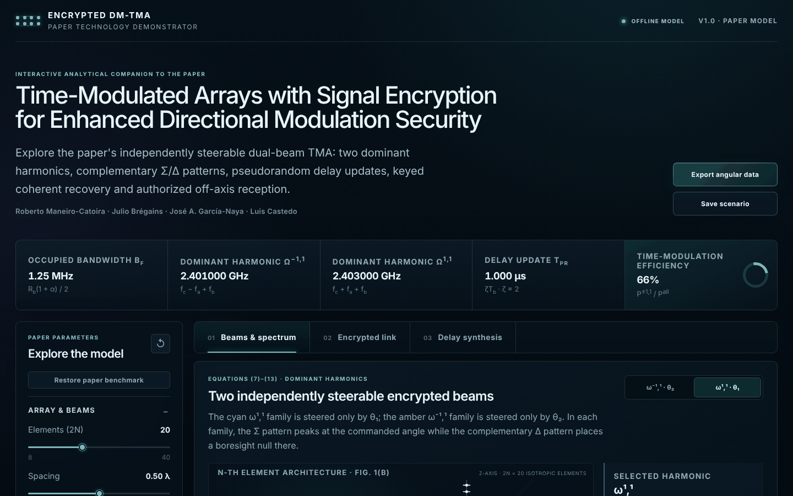
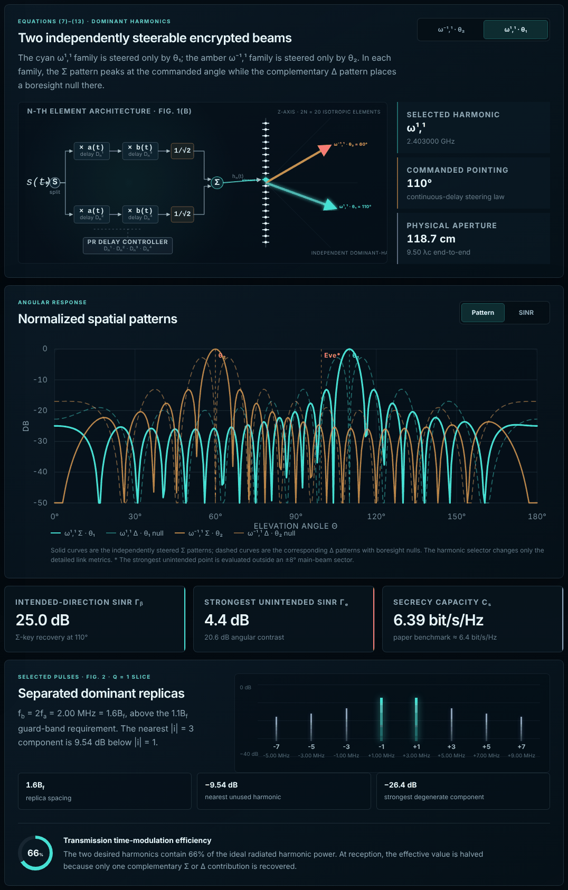
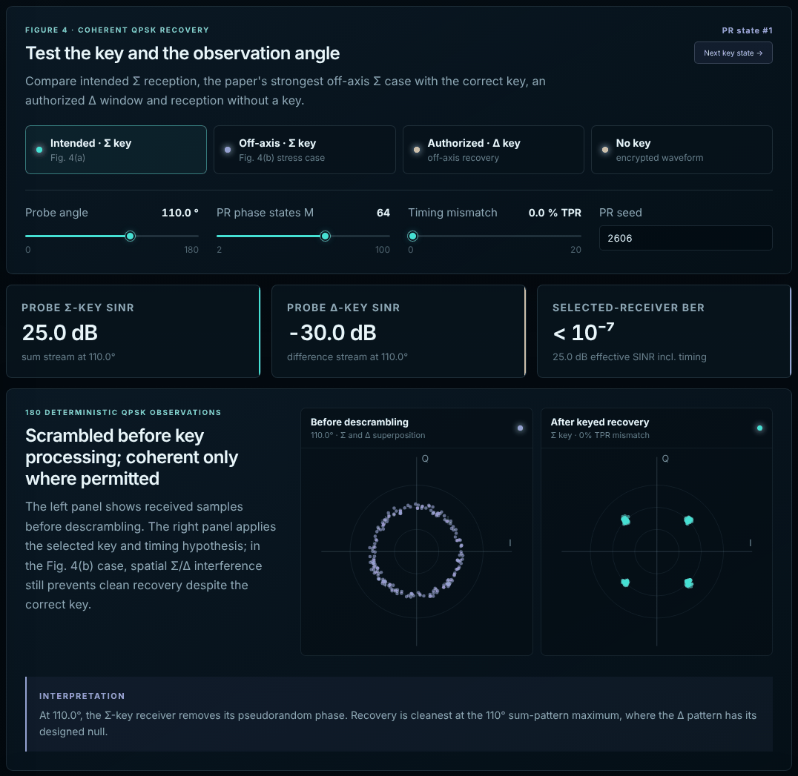
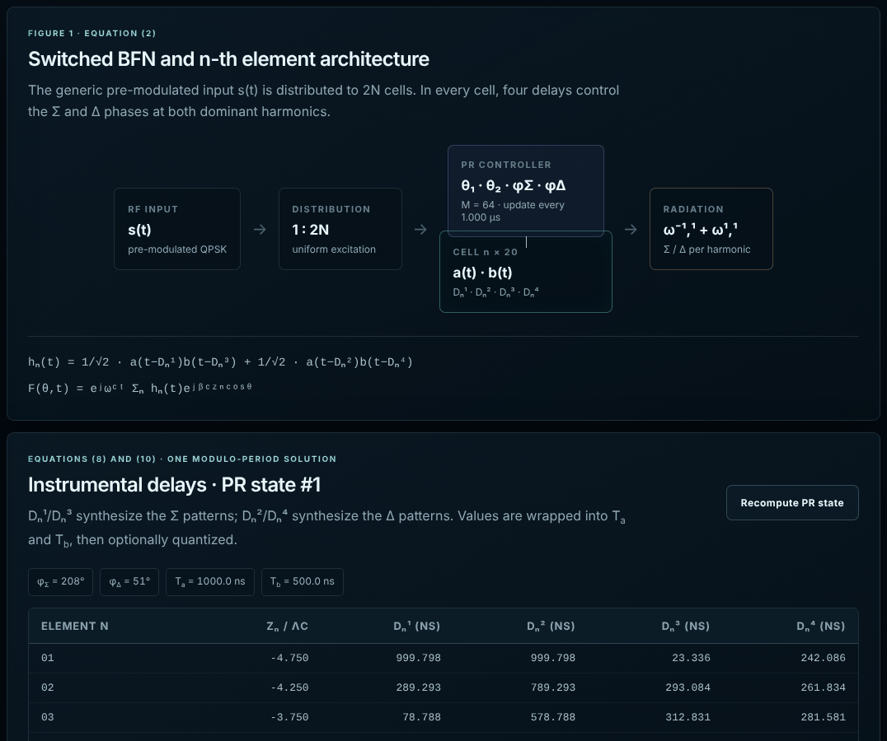

# User tutorial: Signal-Encrypting DM-TMA Demonstrator

**Web application guide · version 1.0 · October 30, 2026**

Companion document to the paper *Time-Modulated Arrays with Signal Encryption
for Enhanced Directional Modulation Security*, by Roberto Maneiro-Catoira,
Julio Brégains, José A. García-Naya and Luis Castedo, submitted to the
*IEEE Antennas and Wireless Propagation Letters*.

**Live demonstrator:** <https://gtec-udc.github.io/tma_signal_encryption_dm/>

## Contents

1. [Purpose of this tutorial](#1-purpose-of-this-tutorial)
2. [Getting started](#2-getting-started)
3. [Minimum model background](#3-minimum-model-background)
4. [Interface organization](#4-interface-organization)
5. [Left panel: adjustable parameters](#5-left-panel-adjustable-parameters)
6. [Top strip of derived quantities](#6-top-strip-of-derived-quantities)
7. [Tab 01: Beams & spectrum](#7-tab-01-beams--spectrum)
8. [Tab 02: Encrypted link](#8-tab-02-encrypted-link)
9. [Tab 03: Delay synthesis](#9-tab-03-delay-synthesis)
10. [Global buttons and exported files](#10-global-buttons-and-exported-files)
11. [Reference case from the paper](#11-reference-case-from-the-paper)
12. [Guided experiments](#12-guided-experiments)
13. [What changes when each parameter is modified](#13-what-changes-when-each-parameter-is-modified)
14. [Assumptions, scope, and precautions](#14-assumptions-scope-and-precautions)
15. [Frequently asked questions](#15-frequently-asked-questions)
16. [Appendix A: checklist for a public demonstration](#appendix-a-checklist-for-a-public-demonstration)
17. [Appendix B: benchmark quick reference](#appendix-b-benchmark-quick-reference)

## 1. Purpose of this tutorial

This document explains how to open, operate, and interpret the
*Signal-Encrypting DM-TMA Demonstrator*. The application interactively
reproduces the analytical model of the associated paper: a time-modulated
uniform linear array (TMA), with two dominant harmonics, independently
steerable beams, complementary sum/difference patterns (Σ/Δ), pseudorandom
delay updates, and coherent key-based recovery.

The guide is intended both for a first demonstration and for technical
analysis. In particular, it details:

- the physical meaning of all sliders, fields, and buttons;
- which quantities are recalculated when each parameter is modified;
- how to read the patterns, link metrics, and constellations;
- how to reproduce the numerical case from the paper;
- how to export results and perform comparative experiments;
- the assumptions and limitations of the model.

> [!NOTE]
> **Key idea.** The demonstrator is not a precomputed animation. Every control
> change locally recalculates the delays, array factors, angular metrics and,
> when applicable, the QPSK constellations. No data are transmitted over the
> Internet.

## 2. Getting started

### 2.1 Online use

Open <https://gtec-udc.github.io/tma_signal_encryption_dm/> in a recent web
browser with JavaScript enabled. Although the page is served from GitHub Pages,
all computations run locally in the browser and no data are sent back.

### 2.2 Offline use

1. Download the repository
   [GTEC-UDC/tma_signal_encryption_dm](https://github.com/GTEC-UDC/tma_signal_encryption_dm)
   (`Code` → `Download ZIP`) or its archived release, and fully extract it.
2. Open the [`web-demo`](../web-demo/) folder.
3. Double-click `index.html`.

The default browser will open the application. No installation, account, or
Internet connection is required. Alternatively, the folder can be opened in
Visual Studio Code and run with *Live Server*; this step is optional.

### 2.3 Included files

The runtime files of the [`web-demo`](../web-demo/) folder are:

| File | Function |
|---|---|
| `index.html` | Entry point; supports direct opening. |
| `app.js` | Self-contained interface and numerical engine. |
| `styles.css` | Visual presentation and responsive layout. |
| `favicon.svg` | Application icon. |
| `data/model-info.json` | Metadata, implemented equations, assumptions, and benchmark. |
| `README_ES.txt` | Brief opening and scope instructions (in Spanish). |
| `MANIFEST.json` | File sizes and SHA-256 hashes for checking distribution integrity. |
| `THIRD_PARTY_NOTICES.md`, `licenses/`, `app.js.LEGAL.txt` | Licenses of the libraries included in `app.js`. |

The same folder contains the editable source code (`src/`) and the build and
test scripts, described in its [developer README](../web-demo/README.md).

> [!WARNING]
> **If the browser displays a blank page.** Check that the archive has been
> fully extracted and that `index.html`, `app.js`, and `styles.css` remain in
> the same folder. If a corporate policy prevents JavaScript from running from
> a local file, use the online version or Visual Studio Code's *Open with Live
> Server* option.

## 3. Minimum model background

### 3.1 Array and useful harmonics

The system uses $2N$ isotropic elements with uniform excitation and spacing
$d$ expressed in carrier wavelengths. Each element receives the premodulated
signal $s(t)$ through a cell with four delays:

```math
h_n(t)=\frac{1}{\sqrt{2}}\,a\!\left(t-D_n^1\right)b\!\left(t-D_n^3\right)
+\frac{1}{\sqrt{2}}\,a\!\left(t-D_n^2\right)b\!\left(t-D_n^4\right). \tag{1}
```

Delays $D_n^1$ and $D_n^3$ synthesize the sum-type (Σ) patterns, whereas
$D_n^2$ and $D_n^4$ synthesize the difference-type (Δ) patterns. The
demonstrator focuses on the two dominant harmonics

```math
f^{-1,1}=f_c-f_a+f_b,\qquad f^{1,1}=f_c+f_a+f_b, \tag{2}
```

which can be independently steered toward $\theta_2$ and $\theta_1$,
respectively.

### 3.2 Bandwidth and pseudorandom updating

For QPSK with root-raised-cosine filtering, the demonstrator computes

```math
B_f=\frac{R_b(1+\alpha)}{2},\qquad f_b=\rho B_f,\qquad f_a=\frac{f_b}{2}, \tag{3}
```

where $\rho=f_b/B_f$ is the control labeled `Spectral spacing`. The delay
update interval is

```math
T_{\mathrm{PR}}=\zeta T_b=\frac{\zeta}{f_b}, \tag{4}
```

where $T_b=1/f_b$ is the period of $b(t)$. In the benchmark, $f_b=R_b$, so
$T_b$ also equals the bit period and $T_{\mathrm{PR}}=2T_b$ equals the QPSK
symbol period $T_s$.

In each interval, two independent pseudorandom phases, $\phi_\Sigma$ and
$\phi_\Delta$, are selected from an alphabet of $M$ equiprobable values:

```math
\phi_\Sigma,\ \phi_\Delta\in\left\lbrace\frac{2\pi k}{M}\right\rbrace_{k=0}^{M-1}. \tag{5}
```

An authorized receiver knows the corresponding sequence and can remove the
pseudorandom phase. Recovery remains direction-dependent because the Σ and Δ
contributions interfere spatially.

$M$ should be a multiple of the modulation order (four for QPSK); the paper
uses $M=64$. Only then does the set of scrambling phases contain the rotations
that map the QPSK symbols onto one another, so that, without the key, the
scrambled symbols are statistically independent of the data. For other values
the scrambled phase leaks information; for example, with $M=50$ it leaks one
bit of information per QPSK symbol.

### 3.3 Displayed metrics

For the selected harmonic, the application evaluates the SINR of the two keys
from the normalized pattern powers:

```math
\gamma_\Sigma(\theta)=\frac{\lvert F_\Sigma(\theta)\rvert^2}{\lvert F_\Delta(\theta)\rvert^2+P_N},
\qquad
\gamma_\Delta(\theta)=\frac{\lvert F_\Delta(\theta)\rvert^2}{\lvert F_\Sigma(\theta)\rvert^2+P_N}, \tag{6}
```

with $P_N=10^{-\mathrm{SNR}/10}$. The displayed secrecy capacity is

```math
C_s=\left[\log_2(1+\gamma_b)-\log_2(1+\gamma_e)\right]^+, \tag{7}
```

where $\gamma_b$ corresponds to the intended direction and $\gamma_e$ to the
most favorable unintended point outside a ±8° sector around the main beam.

The BER estimate uses the coherent QPSK expression
$\mathrm{BER}=\tfrac{1}{2}\operatorname{erfc}\sqrt{\gamma}$, with the SINR
taken per bit, which is the convention of the BER curves in Fig. 3(b) of the
paper. In no-key mode,
$\mathrm{BER}\simeq 0.5$ is displayed, corresponding to random decisions; this
holds when $M$ is a multiple of four ([Section 3.2](#32-bandwidth-and-pseudorandom-updating)).

## 4. Interface organization



The window is divided into four areas:

1. **Header and global actions:** title, offline status, and export buttons.
2. **Derived-quantity strip:** $B_f$, the frequencies of the two harmonics,
   $T_{\mathrm{PR}}$, and ideal efficiency.
3. **Left panel:** global parameters for the array, signal, and delay
   quantization.
4. **Main area:** three tabs for beams/spectrum, encrypted link, and delay
   synthesis.

### 4.1 Using the sliders

Each slider displays its current value at the upper right and the allowed
endpoints below the track. It can be dragged with the mouse or focused with a
click and adjusted with the arrow keys. Each keystroke changes exactly the
increment specified in the tables in this tutorial.

The `Array & beams`, `Signal`, and `Hardware realism` headings are collapsible
panels. Clicking a heading only shows or hides the controls; it does not
modify their values.

## 5. Left panel: adjustable parameters

### 5.1 `Array & beams` group

| Control | Range; step | Paper | Meaning and effect | Purpose |
|---|---|---|---|---|
| `Elements (2N)` | 8–40; 2 | 20 | Total number of elements. Only even values are accepted because the Δ synthesis divides the array into two halves. Increasing $2N$ enlarges the aperture, narrows the main beam, and changes the sidelobe structure. | Study angular resolution, ideal array gain, and spatial contrast. |
| `Spacing` | 0.25–0.75 $\lambda_c$; 0.01 $\lambda_c$ | 0.50 $\lambda_c$ | Normalized uniform spacing. It changes the physical aperture and the pattern. Above 0.5 $\lambda_c$, especially for large scan angles, grating lobes may appear. | Analyze trade-offs among size, beamwidth, and angular ambiguities. |
| `f₊ beam θ₁` | 10–170°; 1° | 110° | Direction of the Σ maximum of harmonic $\omega^{1,1}$ (cyan family). Its complementary Δ pattern places a null in the same direction. | Demonstrate steering of the first beam without moving the second. |
| `f₋ beam θ₂` | 10–170°; 1° | 60° | Direction of the Σ maximum of harmonic $\omega^{-1,1}$ (orange family). The associated Δ pattern places its null there. | Demonstrate independent steering of the second beam. |

The angle $\theta$ is measured from the positive array axis: 90° is
*broadside*, while 0°/180° are the two *endfire* directions. The model uses
$\cos\theta$ in the spatial phase.

### 5.2 `Signal` group

| Control | Range; step | Paper | Meaning and effect | Purpose |
|---|---|---|---|---|
| `Carrier` | 1–12 GHz; 0.05 GHz | 2.4 GHz | Carrier frequency $f_c$. It sets $\lambda_c=c/f_c$, the absolute harmonic frequencies, and the aperture expressed in centimeters. Since $d$ is specified in $\lambda_c$, it does not by itself alter the normalized angular pattern. | Scale the same normalized design to other frequency bands. |
| `QPSK bit rate` | 0.5–20 Mbit/s; 0.5 Mbit/s | 2 Mbit/s | Bit rate $R_b$. Through Eq. (3), it changes $B_f$ and therefore $f_a$, $f_b$, $T_{\mathrm{PR}}$, and the physical delay values. | Evaluate temporal scalability and hardware requirements. |
| `RRC roll-off` | 0–0.50; 0.05 | 0.25 | Root-raised-cosine roll-off factor $\alpha$. Increasing it broadens $B_f$; with $f_b/B_f$ held constant, it also increases the absolute spacing of the replicas. | Study the trade-off between pulse shaping and occupied bandwidth. |
| `Spectral spacing fᵦ / Bf` | 1.1–2.5; 0.1 | 1.6 | Ratio $\rho=f_b/B_f$. It determines $f_b$ and $f_a=f_b/2$. The lower limit implements the separation requirement $f_b\geq 1.1B_f$. | Explore spectral margin, harmonic frequencies, and switching periods. |
| `Update factor ζ` | 1–8; 1 | 2 | Integer number of $T_b$ periods for which each delay state remains active: $T_{\mathrm{PR}}=\zeta T_b$. A larger value slows key updating; a smaller one accelerates it. | Compare scrambling rates and synchronization requirements. |
| `Peak SNR` | 5–35 dB; 1 dB | 25 dB | Reference SNR at the intended maximum. It changes the noise floor, SINR curves, BER, and $C_s$; it does not change the noise-free array factors. | Study link robustness and secrecy capacity versus noise. |

### 5.3 `Hardware realism` group

| Control | Range; step | Paper | Interpretation |
|---|---|---|---|
| `Delay resolution` | 0–250 ps; 25 ps | 0 ps | At 0, ideal continuous delays are used. A nonzero value rounds each $D_n^1,\ldots,D_n^4$ to the nearest multiple of that resolution. This makes it possible to estimate null filling and SINR degradation caused by quantization. |

Quantization is an extension provided by the demonstrator; the numerical
results of the paper assume ideal delays. In the benchmark, 250 ps is small
compared with $T_b$ = 0.5 µs, so the change may be subtle. As a
reference, the paper estimates that random delay errors of rms value
$\sigma_D$ fill the Δ nulls with a residual-to-useful ratio of about
$\sigma_\psi^2/(2N)$ at $\theta_1$, where
$\sigma_\psi=2\pi\sigma_D(f_a^2+f_b^2)^{1/2}$. A quantization step $q$
produces an rms error of about $q/\sqrt{12}$, that is, 72 ps for $q=250$ ps,
which gives a residual of about −73 dB in the benchmark. The effect becomes
easier to observe by first increasing the bit rate or $f_b/B_f$.

### 5.4 Restoring the benchmark

The `Restore paper benchmark` button and the circular ↺ icon perform the same
action. They restore the main parameters, the Σ receiver, the probe angle, and
the first PR state.

> [!WARNING]
> **Reproducibility detail for version 1.0.** The restore button does not
> change the `PR seed` field, the selected harmonic, the `Pattern`/`SINR` mode,
> or the active tab. To reproduce the reference case exactly, also enter
> `PR seed = 2606` and select $\omega^{1,1}$ whenever metrics for the first
> harmonic are required.

## 6. Top strip of derived quantities

These boxes are not controls; they are results that update immediately:

| Box | Calculation | How to interpret it |
|---|---|---|
| `Occupied bandwidth Bf` | $R_b(1+\alpha)/2$ | Occupied bandwidth of the pulse-shaped QPSK signal. |
| `Dominant harmonic ω⁻¹,¹` | $f_c-f_a+f_b$ | Absolute frequency of the beam governed by $\theta_2$. |
| `Dominant harmonic ω¹,¹` | $f_c+f_a+f_b$ | Absolute frequency of the beam governed by $\theta_1$. |
| `Delay update TPR` | $\zeta/f_b$ | Time between two consecutive delay/key sets. |
| `Time-modulation efficiency` | 66% | Ideal fraction of radiated harmonic power in the two useful harmonics. |

The 66% value is a property of the selected pulse waveforms and remains fixed
in this version. At the receiver, the effective efficiency is halved because
only one of the complementary Σ or Δ contributions is recovered.

## 7. Tab 01: `Beams & spectrum`



### 7.1 Harmonic selector

The `ω⁻¹,¹ · θ₂` and `ω¹,¹ · θ₁` buttons select the harmonic used for:

- the `Selected harmonic` and `Commanded pointing` boxes;
- $\gamma_b$, $\gamma_e$, and $C_s$;
- the exported CSV data;
- the encrypted-link tab and its constellations.

The selector does not hide the other family in the plot: both remain visible,
but the active harmonic is drawn with greater emphasis.

### 7.2 Array diagram and architecture of the *n*-th element

The left side of the diagram represents Eq. (1):

- the signal $s(t)$ is split into two branches;
- the upper branch uses $D_n^1$ with $a(t)$ and $D_n^3$ with $b(t)$;
- the lower branch uses $D_n^2$ with $a(t)$ and $D_n^4$ with $b(t)$;
- both branches are weighted by $1/\sqrt{2}$ and added to form $h_n(t)$;
- the PR controller updates all four delays.

The right side shows the $2N$ elements and two straight arrows: cyan for
$\omega^{1,1}/\theta_1$ and orange for $\omega^{-1,1}/\theta_2$. The side boxes
report the active harmonic, its pointing direction, and the physical aperture

```math
L=(2N-1)\,d\,\lambda_c. \tag{8}
```

### 7.3 `Pattern` and `SINR` buttons

- **`Pattern`** displays $10\log_{10}\lvert F(\theta)\rvert^2$. Solid curves
  are Σ patterns and dashed curves are their complementary Δ patterns. Each Σ
  curve has a maximum at the commanded angle and the corresponding Δ curve has
  a null there.
- **`SINR`** displays recoverability with the Σ key versus angle for both
  harmonics. This is the most direct view for locating reception windows and
  regions that are unfavorable for an unintended receiver.

The vertical lines mark $\theta_1$, $\theta_2$, and `Eve*`. The latter is the
point with the highest Σ SINR outside the excluded ±8° sector around the
active beam; it does not represent a fixed position.

### 7.4 Metric boxes

| Metric | Meaning |
|---|---|
| `Intended-direction SINR γb` | Σ-key recovery SINR exactly at the commanded angle of the active harmonic. |
| `Strongest unintended SINR γe` | Highest Σ SINR found outside the main ±8° sector. The note below shows $\gamma_b-\gamma_e$. |
| `Secrecy capacity Cs` | Value of Eq. (7), expressed in bit/s/Hz. If $\gamma_e\geq\gamma_b$, it is clipped to zero. |

These three metrics always correspond to the selected harmonic, even though
the angular plot simultaneously displays both families.

### 7.5 Spectrum and efficiency

The `Separated dominant replicas` panel represents the $q=1$ slice for the odd
indices $i\in\lbrace -7,-5,\ldots,5,7\rbrace$. Beneath each bar, the offset
$if_a+f_b$ relative to $f_c$ is shown.

- The $i=\pm 1$ bars are the useful harmonics.
- The nearest unused component, $\lvert i\rvert=3$, is 9.54 dB below
  $\lvert i\rvert=1$.
- The strongest indicated degenerate component is 26.4 dB below.
- The two desired harmonics contain 66% of the ideal radiated harmonic power.

## 8. Tab 02: `Encrypted link`



This tab makes it possible to compare the received signal before descrambling
with the recovery obtained by different receivers. The 180 QPSK observations
are deterministic for the same parameter set, seed, and angle.

### 8.1 Receiver buttons

| Button | Automatic action | Interpretation |
|---|---|---|
| `Intended · Σ key` | Sets `Probe angle` to $\theta_1$ or $\theta_2$, depending on the harmonic. | Intended receiver with the Σ key. This corresponds to the clean-recovery case in Fig. 4(a) of the paper: Σ maximum and Δ null. |
| `Off-axis · Σ key` | Sets the probe to the `Eve*` angle. | Stress case of Fig. 4(b). The receiver knows the Σ key, but spatial Σ/Δ interference prevents a clean constellation. This demonstrates that knowing the sequence alone is not sufficient in every direction. |
| `Authorized · Δ key` | Sets the probe to the Δ-SINR maximum. | Authorized receiver outside the conventional beam. It uses the Δ key and exploits a complementary spatial window, as in Fig. 4(c). |
| `No key` | Sets the probe to `Eve*` and omits descrambling. | Represents a receiver that does not know the PR sequence. The phase remains randomized and the BER is shown as ≃ 0.5. |

After pressing a preset, you can manually move `Probe angle`; the selected
receiver/key type is retained.

### 8.2 Security controls

| Control | Range; step | Paper | Effect | Recommended use |
|---|---|---|---|---|
| `Probe angle` | 0–180°; 0.5° | 110° for $\omega^{1,1}$ | Angle at which the two probe SINRs and the constellations are computed. It does not move the beams; it only moves the observation point. | Manually scan the angular domain and locate reception windows. |
| `PR phase states M` | 2–100; 1 | 64 | Number of equiprobable phases in Eq. (5). It changes the sequence, instantaneous phases, and delays, but not the ideal pattern envelope with continuous delays. Use multiples of four; otherwise the scrambled phase leaks data information ([Section 3.2](#32-bandwidth-and-pseudorandom-updating)), and a warning is displayed. | Compare small and dense PR alphabets. |
| `Timing mismatch` | 0–20% of $T_{\mathrm{PR}}$; 0.5% | 0% | Normalized timing offset of the descrambling sequence. The BER estimate and the processed constellation include the residual power after matched filtering ([Section 8.5](#85-timing-sensitivity)). | Evaluate sensitivity to synchronization. |
| `PR seed` | 1–999999; numeric field | 2606 | Seed of the deterministic pseudorandom generator. The same seed reproduces the same sequence; a different seed produces a different realization. | Repeatability, realization comparison, and scenario documentation. |

### 8.3 `Next key state` button

It increments the PR-state index from #1 through #96 and then returns to the
first state. $\phi_\Sigma$, $\phi_\Delta$, and the associated delays change.
With continuous delays, the phases change without shifting the maxima and
nulls of the ideal patterns; with quantization, small variations may appear.

### 8.4 Data boxes and constellations

| Box | Meaning |
|---|---|
| `Probe Σ-key SINR` | SINR obtained by a Σ receiver at `Probe angle`. |
| `Probe Δ-key SINR` | SINR obtained by a Δ receiver at the same angle. |
| `Selected-receiver BER` | BER of the selected receiver, including timing mismatch. In `No key`, it is fixed at ≃ 0.5. |

The left constellation, `Before descrambling`, shows the superposition Σ + Δ
before the key is applied. The right one shows the output after the selected
processing. The four ideal QPSK symbol centers are marked as a reference. A
compact cloud around them indicates recovery; a dispersed, rotated, or
elongated cloud indicates noise, an incorrect key, or spatial interference.

### 8.5 Timing sensitivity

The lower panel applies the timing-offset model of the paper. A receiver whose
descrambling sequence is offset by $\Delta t$ leaves the scrambling phase
uncompensated over a fraction $\Delta t/T_{\mathrm{PR}}$ of each interval.
Since the $M$ phase differences are equiprobable, the residual-to-useful power
ratio before matched filtering (MF) is

```math
\left.\frac{P_{\mathrm{res}}}{P_{\mathrm{useful}}}\right|_{\text{before MF}}=2\,\frac{\Delta t}{T_{\mathrm{PR}}}. \tag{9}
```

The uncompensated fraction lies at the edge of the symbol, where the matched
filter gives little weight. For $T_{\mathrm{PR}}=T_s$, as in the benchmark, the
ratio after matched filtering is only about

```math
\left.\frac{P_{\mathrm{res}}}{P_{\mathrm{useful}}}\right|_{\text{after MF}}\simeq\left(\frac{\Delta t}{T_{\mathrm{PR}}}\right)^2, \tag{10}
```

and this is the value that determines the BER. Both expressions are
approximations for small offsets. For example:

| $\Delta t/T_{\mathrm{PR}}$ | Before MF | After MF | $\gamma_b$ (benchmark) |
|:---:|:---:|:---:|:---:|
| 2% | 0.04 | 4 × 10⁻⁴ (−34 dB) | 24.5 dB |
| 4% | 0.08 | 1.6 × 10⁻³ (−28 dB) | 23.2 dB |
| 10% | 0.20 | 10⁻² (−20 dB) | 18.8 dB |

Degradation is therefore gradual rather than an immediate binary failure, and
offsets of a few percent of $T_{\mathrm{PR}}$ have a small impact.

The panel displays both ratios, and the effective SINR shown below the BER
uses the one after matched filtering. The processed constellation illustrates
the same value: every descrambled sample mixes a small fraction of the adjacent
key state, so the clouds widen slightly without rotating. Eq. (10) was derived
for $T_{\mathrm{PR}}=T_s$, which holds when $\zeta=(f_b/B_f)(1+\alpha)$, as in
the benchmark. For other settings of `Update factor ζ`, `Spectral spacing` or
`RRC roll-off`, the demonstrator states it and uses the conservative value of
Eq. (9) instead; the constellation then applies the adjacent key state to that
fraction of the samples.

## 9. Tab 03: `Delay synthesis`



### 9.1 Architecture diagram

The flow summarizes the implementation:

**RF input $s(t)$** → **1:2N distribution** → **2N cells with
$D_n^1,\ldots,D_n^4$** → **radiation $\omega^{-1,1}+\omega^{1,1}$**

The controller receives $\theta_1$, $\theta_2$, $\phi_\Sigma$, and
$\phi_\Delta$, solves the four delays for each cell, and holds them constant
for $T_{\mathrm{PR}}$.

### 9.2 `Recompute PR state` button

It has the same effect on the PR index as `Next key state`: it advances to the
next state in the sequence and recomputes the table. The name emphasizes that,
on this tab, the focus is on the new physical delay values.

### 9.3 Phase and period summary

The four boxes above the table show:

- $\phi_\Sigma$ and $\phi_\Delta$ for the current state, in degrees;
- $T_a=1/f_a$, the period of the modulation signal $a(t)$;
- $T_b=1/f_b$, the period of the modulation signal $b(t)$.

### 9.4 Delay table

Each row corresponds to an element $n$:

| Column | Content |
|---|---|
| `Element n` | Element index, from 1 to $2N$. |
| `zₙ/λc` | Normalized position relative to the array center: $z_n/\lambda_c=\left(n-\frac{2N+1}{2}\right)d$. |
| `Dₙ¹` | Delay of $a(t)$ in the Σ branch; wrapped modulo $T_a$. |
| `Dₙ²` | Delay of $a(t)$ in the Δ branch; wrapped modulo $T_a$. |
| `Dₙ³` | Delay of $b(t)$ in the Σ branch; wrapped modulo $T_b$. |
| `Dₙ⁴` | Delay of $b(t)$ in the Δ branch; wrapped modulo $T_b$. |

The values are expressed in nanoseconds and represent a modulo-period
solution. Therefore, two states may produce numerically different delays while
yielding equivalent harmonic phases. If `Delay resolution` is nonzero,
rounding is applied before the wrapped solution is displayed.

The final `Paper traceability` block contains no controls. It relates the
architecture, delay synthesis, scrambling, and results to the equation and
figure groups in the paper.

## 10. Global buttons and exported files

### 10.1 `Export angular data`

Downloads a CSV file for the currently selected harmonic. It contains 361 rows,
from 0° to 180° in 0.5° steps, and the columns:

```text
theta_deg,sum_pattern_db,difference_pattern_db,sigma_sinr_db,delta_sinr_db
```

The file is named according to the harmonic, for example
`encrypted-dm-tma-omega-1-1.csv`. It is suitable for MATLAB, Python, Excel, or
another plotting and comparison program.

### 10.2 `Save scenario`

Downloads `encrypted-dm-tma-scenario.json`. It stores:

- the selected harmonic;
- all global parameters, including the seed and resolution;
- $B_f$, $f_a$, $f_b$, $f_b/B_f$, the useful frequencies, $T_{\mathrm{PR}}$,
  and the aperture;
- $\gamma_b$, $\gamma_e$, its angle, the best Δ window, and $C_s$;
- the model assumptions.

> [!WARNING]
> **The JSON is a record, not a loadable file.** Version 1.0 does not include a
> `Load scenario` button. The JSON is intended to document, archive, or
> externally process the scenario. To reproduce it in the interface, manually
> enter the values in its `parameters` block. Files are normally saved in the
> browser's Downloads folder.

## 11. Reference case from the paper

To reproduce the benchmark:

1. Press `Restore paper benchmark`.
2. In `Encrypted link`, enter `PR seed = 2606`.
3. In `Beams & spectrum`, select `ω¹,¹ · θ₁`.
4. Select `Pattern` or `SINR`, depending on the quantity you want to view.

| Parameter | Value | Associated result |
|---|---|---|
| $2N$; $d/\lambda_c$ | 20; 0.5 | Normalized aperture $9.5\lambda_c$. |
| $\theta_1$; $\theta_2$ | 110°; 60° | Independent cyan and orange beams. |
| $f_c$; $R_b$; $\alpha$ | 2.4 GHz; 2 Mbit/s; 0.25 | $B_f=1.25$ MHz. |
| $f_b/B_f$; $\zeta$ | 1.6; 2 | $f_a=1$ MHz, $f_b=2$ MHz, and $T_{\mathrm{PR}}$ = 1 µs. |
| $f^{-1,1}$; $f^{1,1}$ | 2.401 GHz; 2.403 GHz | Two spectrally separated useful replicas. |
| SNR; $M$ | 25 dB; 64 | Security benchmark from the paper. |
| Resolution; timing error | 0 ps; 0% | Ideal delays and synchronized receiver. |

For $\omega^{1,1}$, the demonstrator displays approximately

```math
\gamma_b=25.0\ \mathrm{dB},\qquad \gamma_e=4.4\ \mathrm{dB},\qquad C_s=6.39\ \mathrm{bit/s/Hz}. \tag{11}
```

The paper reports $(\gamma_b,\gamma_e)\approx(25,4.5)$ dB, i.e., a 20.5 dB
angular SINR contrast, and $C_s\approx 6.4$ bit/s/Hz. The small difference in
$\gamma_e$ comes from the 0.5° angular grid of the demonstrator: the strongest
unintended maximum lies at about 121.2°, between two grid points.

## 12. Guided experiments

> [!TIP]
> **Experiment 1 · Independent beam steering**
>
> 1. Restore the benchmark and open `Beams & spectrum`.
> 2. Move only `f₊ beam θ₁` from 110° to 130°.
> 3. Check that the cyan curves and arrow move, while the orange family remains
>    at 60°.
> 4. Return $\theta_1$ to 110° and move $\theta_2$.
>
> **Expected conclusion:** each Σ/Δ pair is governed by its own angle and
> dominant harmonic.

> [!TIP]
> **Experiment 2 · Distinguishing pattern from recoverability**
>
> 1. With the benchmark loaded, alternate between `Pattern` and `SINR`.
> 2. In `Pattern`, identify Σ maxima and Δ nulls.
> 3. In `SINR`, compare these features with the recovery windows.
>
> **Expected conclusion:** high radiated amplitude alone does not guarantee
> recovery; what matters is the relationship among the desired contribution,
> the complementary contribution, and noise.

> [!TIP]
> **Experiment 3 · Knowing the key is not always enough**
>
> 1. Select $\omega^{1,1}$ and open `Encrypted link`.
> 2. Press `Intended · Σ key`: the processed constellation should cluster
>    around the four QPSK symbols.
> 3. Press `Off-axis · Σ key`: the key is still correct, but the cloud remains
>    strongly affected by interference.
> 4. Press `No key`: the phase remains undescrambled and the BER is shown as
>    ≃ 0.5.
>
> **Expected conclusion:** security combines temporal scrambling and spatial
> Σ/Δ selectivity.

> [!TIP]
> **Experiment 4 · Authorized reception outside the beam**
>
> 1. In `Encrypted link`, press `Authorized · Δ key`.
> 2. Observe the selected angle and compare `Probe Δ-key SINR` with
>    `Probe Σ-key SINR`.
> 3. Slowly move `Probe angle` to either side of that position.
>
> **Expected conclusion:** the Δ key opens authorized windows that do not
> necessarily coincide with the conventional Σ maximum.

> [!TIP]
> **Experiment 5 · Synchronization error**
>
> 1. Select `Intended · Σ key`.
> 2. Compare `Timing mismatch` equal to 0, 2, 4, and 10%.
> 3. Record the $P_{\mathrm{res}}/P_{\mathrm{useful}}$ ratios, the BER, and the
>    spread of the processed constellation.
>
> **Expected result:** the ratios after matched filtering are 0, 4 × 10⁻⁴,
> 1.6 × 10⁻³, and 10⁻², respectively; the effective SINR decreases
> progressively from 25.0 to about 24.5, 23.2, and 18.8 dB, and the BER remains
> low for offsets of a few percent.

> [!TIP]
> **Experiment 6 · Number and spacing of elements**
>
> 1. Keep $d=0.5\lambda_c$ and compare $2N=8$, 20, and 40.
> 2. Restore $2N=20$ and compare $d=0.25$, 0.50, and 0.75 $\lambda_c$.
>
> **Expected result:** increasing the aperture narrows the beam; large spacings
> may introduce ambiguous maxima, especially far from broadside.

> [!TIP]
> **Experiment 7 · Delay quantization**
>
> 1. Set `QPSK bit rate` to 20 Mbit/s to increase the modulation frequencies
>    and make the effect more visible.
> 2. Compare `Delay resolution` equal to 0, 100, and 250 ps.
> 3. Observe the delay table, the Δ nulls, and the SINR metrics.
>
> **Expected result:** the delays align with the timing grid; phase errors can
> partially fill the nulls and reduce contrast.

> [!TIP]
> **Experiment 8 · Frequency scaling**
>
> 1. Export or note the pattern with $f_c=2.4$ GHz.
> 2. Change only the carrier to 10 GHz.
> 3. Compare the pattern, absolute frequencies, and aperture in centimeters.
>
> **Expected result:** the normalized pattern is preserved, while $\lambda_c$
> and the physical aperture decrease and the replicas shift in frequency.

## 13. What changes when each parameter is modified

The following table is a quick reference. "Yes" means a directly visible
effect; "indirect" means that the change appears through a derived quantity or
the PR realization.

| Parameter | Angular pattern | Frequencies | Delays | SINR / $C_s$ | Constellation | Note |
|---|:---:|:---:|:---:|:---:|:---:|---|
| $2N$ | Yes | No | Yes | Yes | Yes | Changes aperture and coherent summation. |
| $d/\lambda_c$ | Yes | No | Yes | Yes | Yes | May create grating lobes. |
| $\theta_1$, $\theta_2$ | Yes | No | Yes | Yes | Yes | Each angle governs one family. |
| $f_c$ | No, normalized | Yes | No, in this normalized model | No | No | Changes $\lambda_c$ and physical size. |
| $R_b$, $\alpha$, $f_b/B_f$ | Ideally no | Yes | Yes | Indirect with quantization | Indirect | Scale timing and spectral separation. |
| $\zeta$ | No | No | No | Only with timing error | Yes | Changes $T_{\mathrm{PR}}$. |
| SNR | No | No | No | Yes | Yes | Changes noise and BER. |
| Delay resolution | Yes | No | Yes | Yes | Yes | Optional quantization. |
| $M$ and seed | Ideally no | No | Yes | Indirect | Yes | Change the PR realization; use $M$ multiple of 4. |
| Probe angle | No | No | No | Local reading | Yes | Does not move the beam. |
| Timing error | No | No | No | Effective BER | Yes | Does not change the baseline spatial SINR. |

## 14. Assumptions, scope, and precautions

The demonstrator is an analytical, array-factor-level model. It assumes:

- isotropic elements with uniform excitation;
- a coherent channel and, except for the explicit control, perfect
  synchronization;
- ideal switches and continuous delays, except when optional quantization is
  enabled;
- no mutual coupling, RF losses, component dispersion, amplitude/phase errors,
  phase noise, or nonlinearities;
- a LOS-type angular scenario, without an explicit multipath channel;
- ideal spectral isolation of the analyzed harmonic through filtering.

Therefore, the results can be used to verify the architecture, explore trends,
and prepare specifications, but they do not replace a full-wave
electromagnetic simulation, an RF circuit model, or hardware measurements.

> [!IMPORTANT]
> **Good practice when sharing results.** Store the CSV, JSON, and a note with
> the demonstrator version together. Always state the selected harmonic and
> whether delay quantization was used. For a reproducible comparison, also
> record $M$, the seed, the PR state, and the probe angle.

## 15. Frequently asked questions

**Why are both families visible even though I selected one harmonic?**
Because the selector sets the detailed metrics, constellations, and export;
the plot retains both families to show their independence.

**Why does changing the carrier hardly affect the pattern?**
Because the geometry is expressed in $\lambda_c$. The physical dimensions and
absolute frequencies change, but the normalized array factor does not.

**Why can a correct key still produce a poor constellation?**
Outside the appropriate direction, the complementary contribution may
dominate. The key removes the PR phase, but it does not remove spatial Σ/Δ
interference.

**Why does `No key` always show a BER close to 0.5?**
This is the random-decision assumption when the scrambling sequence is
unknown; it is not an estimate obtained from valid coherent demodulation. It
is justified when $M$ is a multiple of four, because the scrambled symbols are
then statistically independent of the data. For other values of $M$, an
eavesdropper could extract part of the information, so the displayed value is
optimistic; the demonstrator then displays a warning.

**Why do the delays change when the state advances but the beam does not?**
The common pseudorandom phase changes between intervals, while the relative
phase laws preserve the commanded maximum and null. Quantization may slightly
break this invariance.

**Can I directly reopen a saved JSON file?**
Not in version 1.0. The JSON documents the scenario; its parameters must be
re-entered manually.

**Why does the CSV not contain both harmonics simultaneously?**
Export follows the active harmonic. Select and export each one separately if
you need to compare both.

## Appendix A: checklist for a public demonstration

- [ ] Open the online demonstrator, or a local copy of `web-demo/index.html`,
      before the session.
- [ ] Press `Restore paper benchmark` and set `PR seed = 2606`.
- [ ] Show the independence of $\theta_1$ and $\theta_2$.
- [ ] Alternate between `Pattern` and `SINR`.
- [ ] Verify approximately 25.0 dB, 4.4 dB, and 6.39 bit/s/Hz for
      $\omega^{1,1}$.
- [ ] Compare the four receiver modes.
- [ ] Show a PR-state change and the $D_n^1,\ldots,D_n^4$ table.
- [ ] Export an example CSV and JSON file.
- [ ] Remind the audience of the assumptions of the analytical model.

## Appendix B: benchmark quick reference

| Parameter | Value | Parameter | Value |
|---|---|---|---|
| $2N$ | 20 | $d/\lambda_c$ | 0.5 |
| $\theta_1$ | 110° | $\theta_2$ | 60° |
| $f_c$ | 2.4 GHz | $R_b$ | 2 Mbit/s |
| $\alpha$ | 0.25 | $B_f$ | 1.25 MHz |
| $f_a$ | 1 MHz | $f_b$ | 2 MHz |
| $f_b/B_f$ | 1.6 | $\zeta$ | 2 |
| $T_{\mathrm{PR}}$ | 1 µs | $M$ | 64 |
| Seed | 2606 | SNR | 25 dB |
| Resolution | 0 ps | Timing error | 0% |

---

Tutorial for web version 1.0 of the *Signal-Encrypting DM-TMA Demonstrator*,
part of the repository
[GTEC-UDC/tma_signal_encryption_dm](https://github.com/GTEC-UDC/tma_signal_encryption_dm).
© 2026 the authors. Licensed under [CC BY 4.0](LICENSE.md). AI assistants were
used in the development of the demonstrator and of this tutorial.
